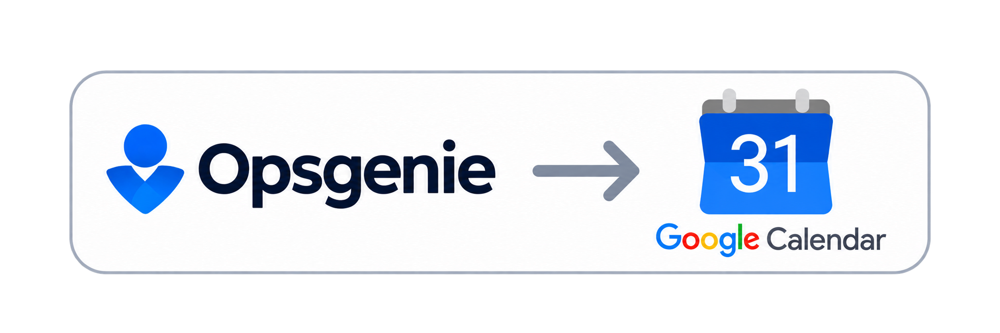

# On-call Calendar Sync


<p align="center">
  
</p>

Keep Opsgenie shifts on the family Google Calendar, without copying them by hand.

```console
oncall-calendar-sync sync
status=success added=1 updated=0 removed=0
```

This small, one-way sync reads an Opsgenie iCalendar feed and reconciles upcoming shifts into one Google Calendar. It leaves other calendar events alone, keeps past shifts as history, and can run unattended after a one-time Google authorization.

## What it does

| Behavior | What to expect |
|---|---|
| Add and update shifts | Upcoming feed entries are created or refreshed in Google Calendar. Repeated runs do not create duplicates. |
| Remove stale future shifts | On a valid, non-empty feed, future entries managed by this sync that disappeared from the feed are removed. |
| Preserve calendar history | Past managed shifts and events created by anyone else are left alone. |
| Fail safely on bad feeds | Empty, unavailable, malformed, or unsupported feeds stop before Google Calendar is changed. |
| Report a concise result | A successful run prints added, updated, and removed counts; failures exit nonzero with a sanitized category. |

## Install and configure

Requires Python 3.12 or later. Install from the repository:

```bash
python -m venv .venv
. .venv/bin/activate
pip install .
```

Keep configuration and Google credentials outside the repository. Create a private config directory and copy the example:

```bash
mkdir -p "$HOME/.config/oncall-calendar-sync"
chmod 700 "$HOME/.config/oncall-calendar-sync"
cp config.example.toml "$HOME/.config/oncall-calendar-sync/config.toml"
chmod 600 "$HOME/.config/oncall-calendar-sync/config.toml"
```

Edit `config.toml` with your Opsgenie iCalendar URL and Google Calendar ID:

```toml
source_ical_url = "https://example.invalid/replace-me.ics"
target_calendar_id = "replace-with-calendar-id"
oauth_client_file = "oauth-client.json"
oauth_token_file = "token.json"
```

Replace both example values with your own. Put a Google Cloud Desktop OAuth client JSON file at `oauth-client.json` in the same directory, and keep that file private (`chmod 600`). The client and token paths may also be absolute; relative paths are resolved from the config directory. The token is created by the authorization step below.

The default config directory is `~/.config/oncall-calendar-sync`. To use another directory, pass `--config-dir` to a command or set `ONCALL_SYNC_CONFIG_DIR`:

```bash
export ONCALL_SYNC_CONFIG_DIR="$HOME/.config/oncall-calendar-sync"
```

## Google Cloud setup (one time)

The sync needs a Google Cloud project so Google can identify the app and let you grant it Calendar access. For one calendar synced once a day, creating the project and using the Calendar API should cost nothing: Google currently lists standard Calendar API use as no additional cost. Google says requests above its daily standard quota may become billable later in 2026; this sync's ordinary daily use is far below that threshold. See [Calendar API quotas and pricing](https://developers.google.com/workspace/calendar/api/guides/quota).

These are manual steps in Google Cloud, but you only need to do them once:

1. [Create or select a Google Cloud project](https://console.cloud.google.com/projectcreate).
2. [Enable the Google Calendar API](https://console.cloud.google.com/marketplace/product/google/calendar-json.googleapis.com) for that project.
3. Configure the consent screen in [Google Auth Platform → Branding](https://console.cloud.google.com/auth/branding): set an app name, support email, and developer contact. In [Audience](https://console.cloud.google.com/auth/audience), choose **External** for a personal Google account. **Internal** is only for accounts in a Google Workspace organization. Add the Google account you will authorize as a test user, and in [Data Access](https://console.cloud.google.com/auth/scopes) add `https://www.googleapis.com/auth/calendar.events`.
4. For unattended runs, change the app's publishing status from **Testing** to **In production** in Audience. Google-issued refresh tokens for external apps left in Testing expire after seven days. Personal apps used by fewer than 100 people do not have to complete OAuth verification, though Google may show an unverified-app warning during authorization. See Google's [personal-use verification exception](https://support.google.com/cloud/answer/13464323) and [refresh-token rules](https://developers.google.com/identity/protocols/oauth2#expiration).
5. In [Google Auth Platform → Clients](https://console.cloud.google.com/auth/clients), create an OAuth client with application type **Desktop app**. Download its JSON file, save it as `oauth-client.json` in your private config directory, and restrict it to your user (`chmod 600`). Google's [Calendar API Python quickstart](https://developers.google.com/workspace/calendar/api/quickstart/python) has the corresponding console walkthrough.

The Google account you authorize must also have edit access to the target calendar. After setup, the sync uses the saved refresh token; scheduled runs do not need the browser.

## Authorize and run

On a machine with a browser, run the one-time consent flow:

```bash
oncall-calendar-sync authorize
status=success authorization_saved
```

The authorization command opens a browser and saves `token.json` with owner-only permissions. To use a custom config location, append `--config-dir /path/to/private/config` to either command. Scheduled sync runs use the saved token and do not open a browser.

Run a sync:

```bash
oncall-calendar-sync sync
status=success added=2 updated=1 removed=1
```

Counts describe changes made in that run. For example, the output above means two entries were added, one changed, and one stale future managed entry was removed. A failure prints to stderr and exits with status 1, for example:

```text
status=failure category=source_fetch_failed added=0 updated=0 removed=0
```

Feed errors are detected before destination changes. Google read or write failures are also reported as failures; if a write fails partway through, the counts show operations completed before the error.

## CLI reference

```text
oncall-calendar-sync {authorize,sync} [--config-dir CONFIG_DIR]
```

| Argument | Description |
|---|---|
| `authorize` | Open Google’s browser consent flow and save the refresh token. Requires the OAuth client file. |
| `sync` | Fetch and validate the feed, then reconcile it with the configured calendar. |
| `--config-dir PATH` | Read `config.toml` from this directory instead of the default or environment override. |
| `-h`, `--help` | Show command help. |

Both commands load and validate `config.toml`, which must include the feed URL and target calendar ID. The OAuth paths are optional and default to `oauth-client.json` and `token.json` in the config directory.

## Run daily with Docker Compose

The included Compose setup mounts your private config read-only into the container. From the repository, set the host path and run:

```bash
export ONCALL_SYNC_CONFIG_DIR="$HOME/.config/oncall-calendar-sync"
docker compose build
docker compose run --rm sync
```

After confirming the results against a dedicated test calendar, schedule the same command on your always-on machine. For example, a daily run at 06:00:

```cron
0 6 * * * cd /path/to/oncall-calendar-sync && ONCALL_SYNC_CONFIG_DIR="$HOME/.config/oncall-calendar-sync" docker compose run --rm sync
```

Replace `/path/to/oncall-calendar-sync` with the checkout location. Check the cron job's exit status or captured output for failures. If Google authorization is revoked, run `authorize` again from a browser-capable machine.

## Feed and calendar rules

The feed must be a non-empty iCalendar snapshot of uniquely identified, timed events. Recurring events, all-day events, cancelled entries, or entries without valid start/end times are unsupported; the whole run fails without changing Google Calendar. Past source shifts are not re-created, while past managed calendar entries remain as history. Only events carrying this application's private ownership marker can be updated or removed.

The sync requests Google Calendar's `calendar.events` scope. Keep the feed URL, calendar ID, OAuth client, and token out of tracked files, logs, and issue reports.

## Contributing

This project uses GitHub Spec Kit for specification-driven development. The Opsgenie sync feature is documented in [`specs/001-opsgenie-calendar-sync/`](specs/001-opsgenie-calendar-sync/); its specification and plan describe the intended behavior and design.

For a new feature or significant change, contributors should follow the repository's Spec Kit workflow: select the next incomplete stage, update the relevant artifacts in `specs/`, and get the required specification and plan approvals before planning and implementation. Use the installed `speckit-*` skills in `.agents/skills/`. Small bug fixes, documentation updates, and trivial refactoring can skip the full workflow, but must still follow the project constitution in `.specify/memory/constitution.md`. Run the automated tests after code changes.

**AI disclosure:** AI assistance was used to prepare this README. Confirm commands and behavior against the implementation and tests when making changes.
